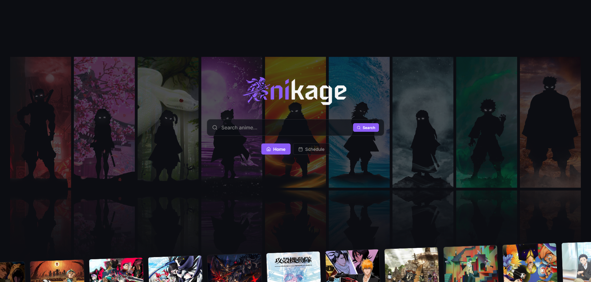
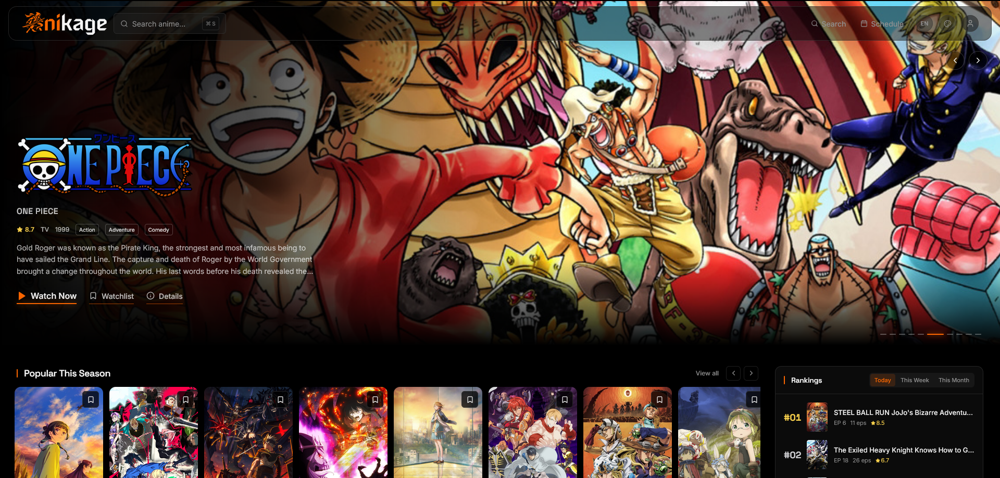
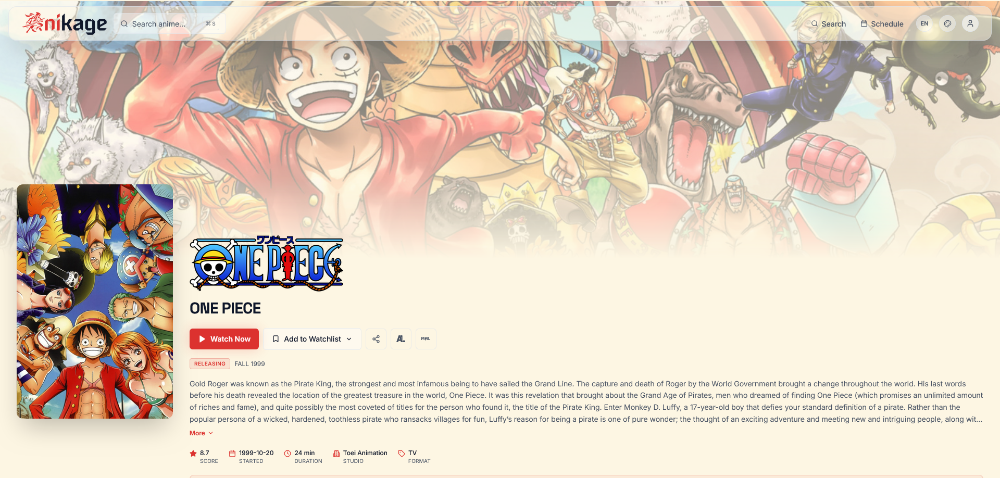
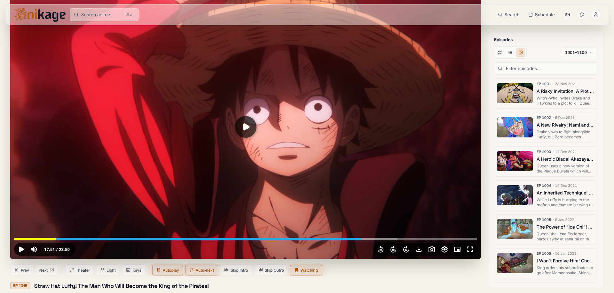

# Anikage is back with V2
AniKage V1 has depricated and will no longer be maintained. all our efforts are now going to developing this site
V1 can be found at [AniKage V1](https://github.com/Anikage-Group/anikagev1)

---

<div align="center">

  
  
  <br/>
  <h1>
    <strong>v2.0.0</strong>
  </h1>
  A cinematic anime streaming application with seamless MyAnimeList & AniList synchronization, beautiful themes, and a premium viewing experience.
</div>


## ✨ Features

### 🎬 **Streaming Experience**
- **Multi-source streaming** — Aggregates streams from multiple providers (H-Sub, S-Sub, Dub, etc.)
- **Smart server selection** — Auto-picks preferred audio (Sub/Dub) with manual override
- **Skip Intro/Outro** — Automatic or manual skip with visual indicators
- **Auto-next episode** — Seamless binge-watching with configurable autoplay
- **Theater mode** — Immersive full-screen viewing
- **Dim mode** — Dim surroundings for focused watching
- **Keyboard shortcuts** — Full playback control without mouse

### 📺 **Watchlist & Progress**
- **Local watchlist** — Add, remove, and manage anime status (Watching, Completed, Planned, Rewatching, Dropped, Paused)
- **Episode progress tracking** — Resume exactly where you left off with second-precision
- **Continue Watching** — Quick access to recently viewed episodes
- **Watched episodes** — Mark episodes as watched locally (75% playback auto-marks)

### 🔄 **Bidirectional Sync (AniList & MyAnimeList)**
- **OAuth authentication** — Secure sign-in with both platforms
- **Automatic progress sync** — Episode progress pushed to both providers on playback
- **Watchlist sync** — Add/remove/status changes sync bidirectionally

### 🎨 **Themes & Customization**
- **20 built-in themes** — Dark & light variants
- **Custom theme builder** — Full color palette editor with live preview
- **Persisted preferences** — All settings saved locally

### 🌍 **Internationalization**
- **3 languages** — English, Japanese (日本語), Romaji
- **Localized UI** — All interface text translated
- **Title preferences** — Display titles in preferred language


---

## 🛠 Technical Stack

| Layer | Technology |
|-------|------------|
| **Framework** | SvelteKit 2 (Svelte 5) |
| **Styling** | Tailwind CSS 3 + CSS Variables |


---

## 📁 Project Structure

```
anikage/
├── src/
│   ├── lib/
│   │   ├── components/
│   │   │   ├── anime/              # Anime cards, episode list, rails, show info
│   │   │   ├── layout/             # Header, footer, mobile nav, toasts, command palette
│   │   │   ├── player/             # EmbedPlayer, ControlBar, WatchlistMenu
│   │   │   └── ui/                 # Reusable UI primitives (Button, Skeleton, etc.)
│   │   ├── config.ts               # App configuration
│   │   ├── services/
│   │   │   ├── aniZip.ts           # ani.zip episode/thumbnails/banner service
│   │   │   ├── anilist.ts          # AniList GraphQL queries
│   │   │   ├── anilistOAuth.ts     # AniList OAuth + sync logic
│   │   │   ├── malOAuth.ts         # MAL OAuth + sync logic
│   │   │   ├── streams.ts          # Stream aggregation & selection
│   │   │   ├── fallback.ts         # Mirror sources (Jikan, Tenrai, Kitsu)
│   │   │   ├── cache.ts            # In-memory + localStorage caching
│   │   │   └── watchSync.ts        # Cross-provider sync orchestration
│   │   ├── stores/
│   │   │   ├── settings.ts         # User preferences
│   │   │   ├── theme.ts            # Theme system (CSS variables)
│   │   │   ├── watchlist.ts        # Local watchlist state
│   │   │   ├── history.ts          # Progress + watched episodes
│   │   │   ├── sync.ts             # Sync bookkeeping (tombstones, snapshots)
│   │   │   ├── i18n.ts             # Translations
│   │   │   └── toast.ts            # Toast notifications
│   │   ├── types.ts                # TypeScript interfaces
│   │   └── utils/                  # Helpers (format, reveal, OG, etc.)
│   ├── routes/
│   │   ├── +layout.svelte          # App shell (header, footer, ambient)
│   │   ├── +page.svelte            # Landing page
│   │   ├── home/                   # Home feed (schedule, continue watching)
│   │   ├── anime/[id]/             # Anime detail page
│   │   ├── watch/[animeId]/[epNo]/ # Watch page with player
│   │   ├── search/                 # Search with command palette
│   │   ├── schedule/               # Airing schedule
│   │   ├── watchlist/              # User's watchlist
│   │   └── settings/               # Settings (appearance, general, account)
│   ├── app.css                     # Global styles, scrollbars, CSS variables
│   ├── app.html                    # HTML template
│   └── app.d.ts                    # TypeScript declarations
├── static/
│   ├── logo-ani.png
│   ├── logo-kage.png
│   ├── favicon.png
│   └── og.png
├── images/                         # README screenshots
│   ├── lander.png
│   ├── home.png
│   ├── anime.png
│   └── player.png
├── .gitignore
├── .vercelignore
├── package.json
├── svelte.config.js
├── vite.config.ts
├── tailwind.config.ts
├── tsconfig.json
└── postcss.config.js
```

---

## ⚙️ Configuration

### OAuth Setup

#### AniList
1. Go to [AniList Developer Settings](https://anilist.co/settings/developer)
2. Create new application
3. Set **Redirect URI** to your deployment URL + `/auth/anilist/callback`
4. Enter Details in the .env file

#### MyAnimeList
1. Go to [MAL API Developer](https://myanimelist.net/apiconfig)
2. Create new application
3. Set **Redirect URI** to your deployment URL + `/auth/mal/callback`
4. Enter Details in the .env file

**API**

You'll need access to a compatible data API instance for anime indexing and m3u8 stream resolution. This can be found at our Github Page <a href="https://github.com/Anikage-Group/Flixcloud-api-lite">Lite AniKage API</a> or <a href="https://github.com/Anikage-Group/api">Full Anikage API</a>

NOTE: Some site sync features are only available with our <a href="https://github.com/Anikage-Group/plyr">player</a>(which only works with the full API)

---

## 🚀 Cloud Deployment

### Vercel

[](https://vercel.com/new/clone?repository-url=https%3A%2F%2Fgithub.com%2FAnikage-Group%2FAniKage&env=PUBLIC_ANIZIP_URL%3Dhttps%3A%2F%2Fapi.ani.zip%2CPUBLIC_ANILIST_URL%3Dhttps%3A%2F%2Fgraphql.anilist.co%2CPUBLIC_TENRAI_URL%3Dhttps%3A%2F%2Fapi.tenrai.dev%2Fv1%2CPUBLIC_JIKAN_URL%3Dhttps%3A%2F%2Fapi.jikan.moe%2Fv4%2CPUBLIC_KITSU_URL%3Dhttps%3A%2F%2Fkitsu.io%2Fapi%2Fedge%2CPUBLIC_MAL_API_URL%3Dhttps%3A%2F%2Fapi.myanimelist.net%2Fv2%2CPUBLIC_MAL_AUTH_URL%3Dhttps%3A%2F%2Fmyanimelist.net%2Fv1%2Foauth2%2Fauthorize%2CPUBLIC_MAL_TOKEN_URL%3Dhttps%3A%2F%2Fmyanimelist.net%2Fv1%2Foauth2%2Ftoken%2CPUBLIC_SOURCE_ORDER%3Da%2Cm%2Cj%2Ct%2Ck%2CPUBLIC_SOURCE_CODE_URL%3Dhttps%3A%2F%2Fgithub.com%2FAnikage-Group%2FAniKage%2CPUBLIC_API_URL%2CPUBLIC_ANILIST_CLIENT_ID%2CANILIST_CLIENT_SECRET%2CPUBLIC_MAL_CLIENT_ID%2CMAL_CLIENT_SECRET&project-name=anikage&repository-name=anikage)


### Manual Vercel Deployment

```bash
# Install Vercel CLI
npm i -g vercel

# Deploy
vercel --prod
```

### Docker

```dockerfile
FROM node:20-alpine AS builder
WORKDIR /app
COPY package*.json ./
RUN npm ci
COPY . .
RUN npm run build

FROM node:20-alpine AS runner
WORKDIR /app
ENV NODE_ENV=production
COPY --from=builder /app/build ./build
COPY --from=builder /app/node_modules ./node_modules
COPY --from=builder /app/package.json ./
EXPOSE 3000
CMD ["node", "build/index.js"]
```

---

## 🧪 Local Development

```bash
# Install dependencies
npm install

# Start dev server
npm run dev

# Type-check
npm run check

# Production build
npm run build

# Preview production build
npm run preview
```


---

## 📸 Screenshots

| Landing | Home Feed | Anime Detail | Player |
|---------|-----------|--------------|--------|
|  |  |  |  |

---

## 🔐 Privacy & Security

- **No tracking** — Zero analytics, no third-party scripts
- **Local-first** — All preferences & watchlist stored in your browser
- **OAuth only** — Tokens never leave your device except to AniList/MAL

---

## 📄 License

MIT License — see [LICENSE](LICENSE) for details.  

---

## ⚠️ Disclaimer:  
  
Some of this Project has been coded using AI. All Crucial components have been coded by hand and all AI generated functions and code have been thoroughly reviewed and edited by our devs.  
  
Estimated 15% code written by AI

Model Used: NVIDIA Nemotron 3 Ultra

---

<div align="center">
  
  
  <br/>
  <strong>Anikage v2.0.0</strong>
</div>